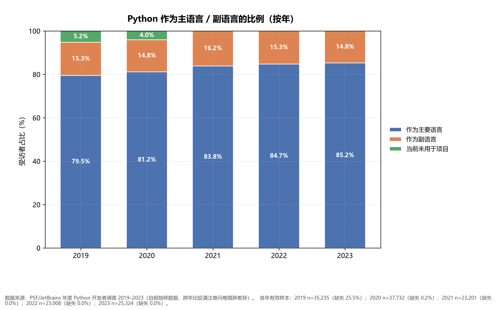
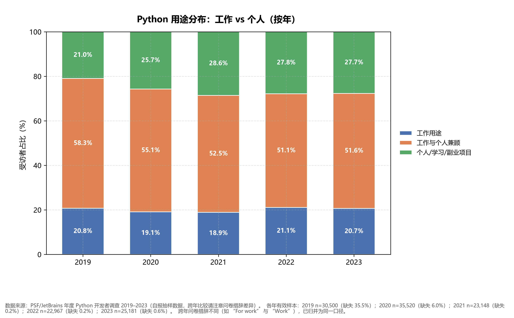
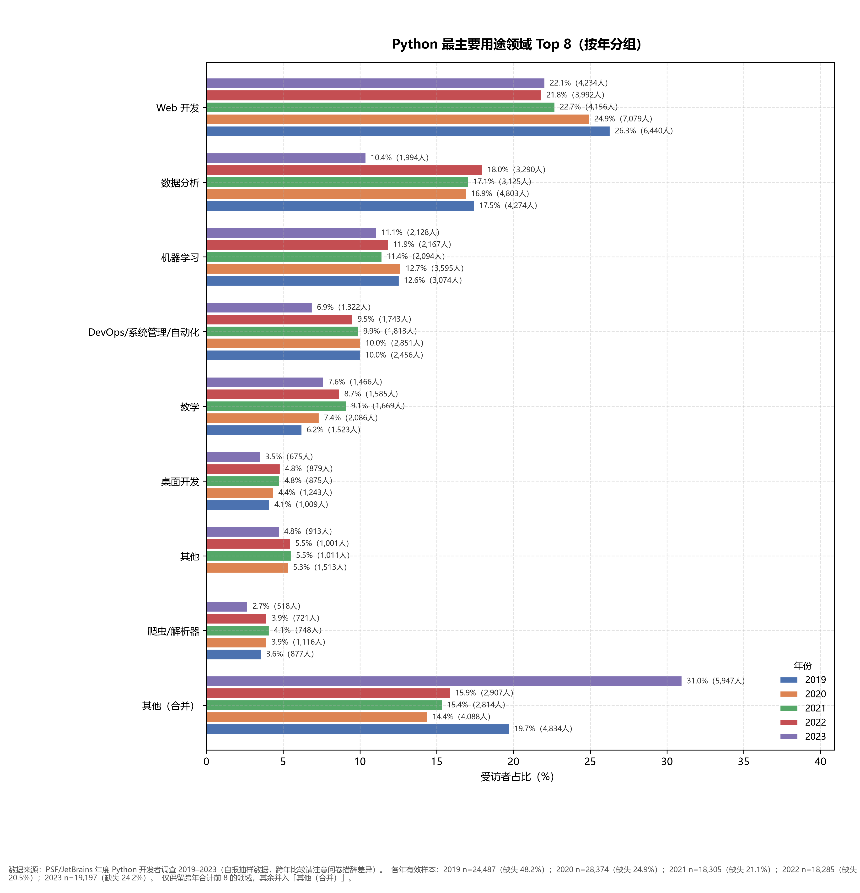
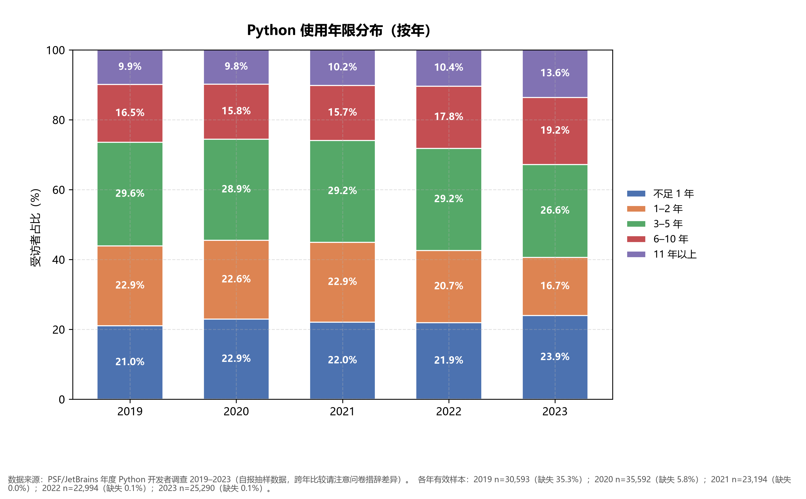
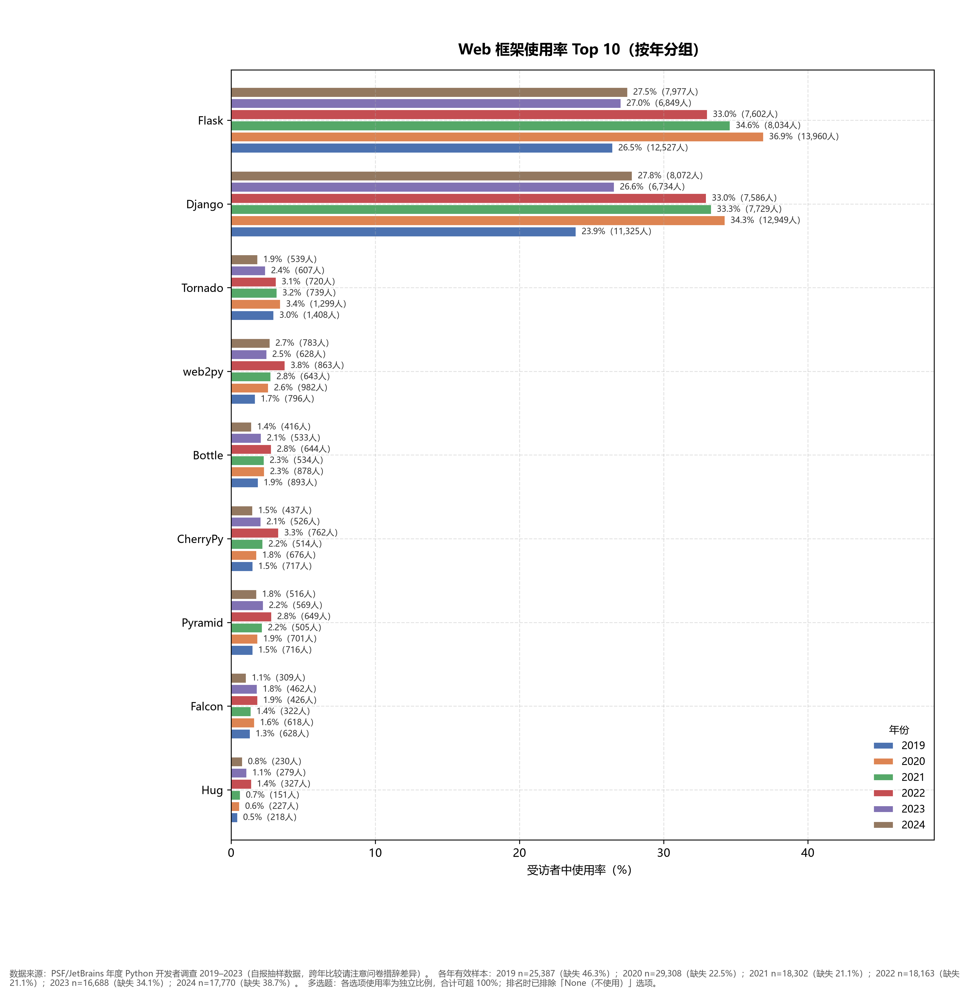
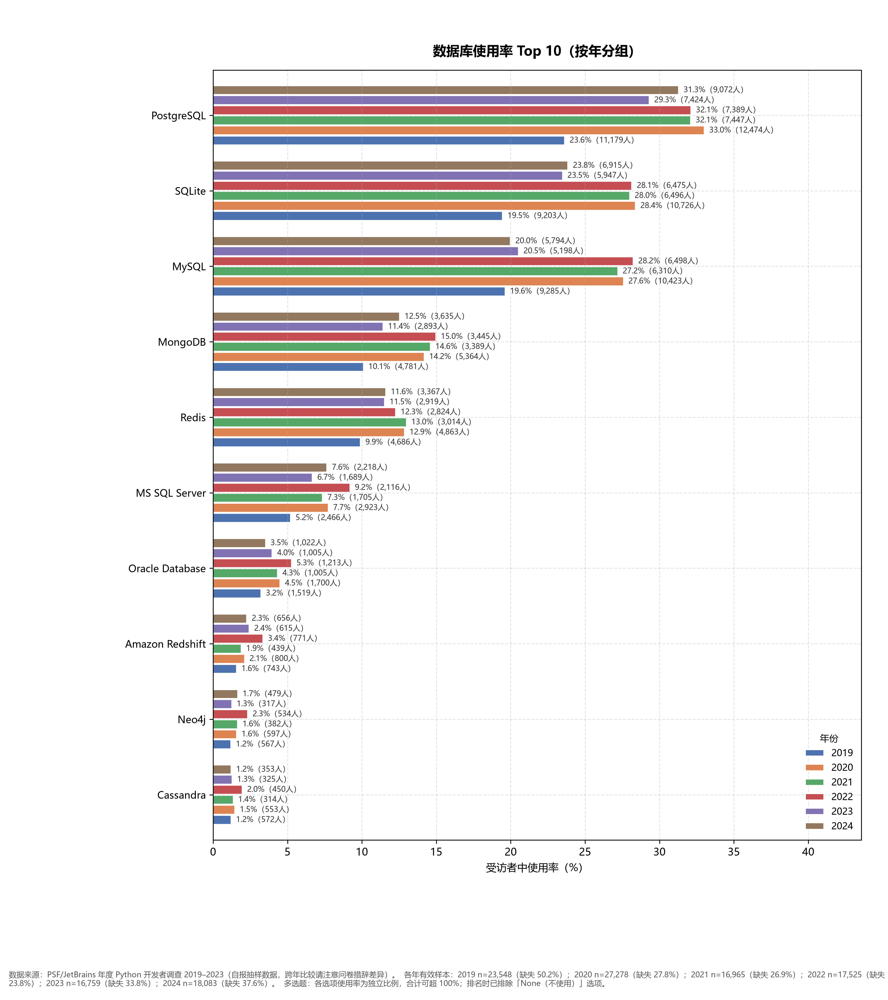
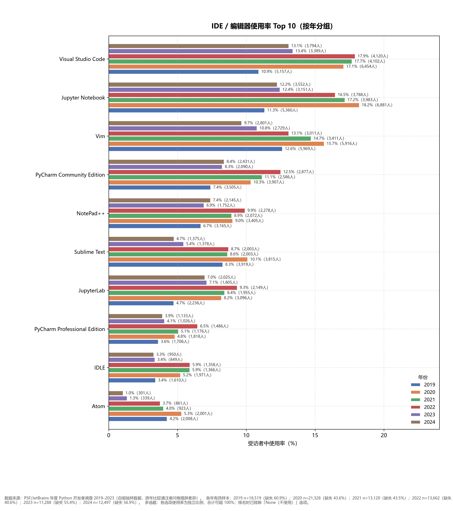
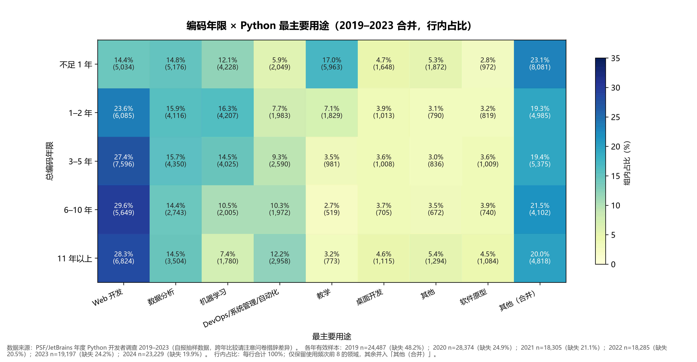

# PSF/JetBrains Python 开发者调查分析报告（2019–2023）

数据来源：PSF 年度 Python 开发者调查（由 JetBrains 提供），2019–2023 五期。分析对象为跨年对齐总表 `aligned/survey_2019_2023_master.csv`（156,635 行 × 154 列），统计图表由 `plot_survey.py` 生成于 `charts/` 目录，报告中全部占比数字与之一致。文末列有解读注意事项。

## 1. 数据概况

各年回收样本如下：

| 年份 | 样本量 |
|------|--------|
| 2019 | 47,308 |
| 2020 | 37,793 |
| 2021 | 23,201 |
| 2022 | 23,009 |
| 2023 | 25,324 |
| 合计 | 156,635 |

样本量在 2020 年后明显收缩：2021 起每年只有 2.3 万–2.5 万份，约为 2019 年的一半。这会影响跨年比较的精度，百分比数字的抽样波动在 1 个百分点上下，读细小差异时要留余地。

数据处理分三步：`clean_survey.py` 负责清洗（去全空行、表头归一），`align_survey.py` 负责跨年列名与取值对齐，`plot_survey.py` 负责聚合绘图。清洗与对齐的具体规则见 `cleaned/cleaning_report.md` 与 `aligned/alignment_report.md`。

## 2. 数据质量与口径差异

### 2.1 原始数据问题

- 2020 年原始文件含 12,554 个全空行，清洗时已删除。
- 2020 年问题清单仅有表头，无法用于核对题目措辞。
- 2019 年原始表头是完整问题文本（`问题:选项`），清洗时映射到统一命名，个别映射可能不完全精确。

### 2.2 缺失情况

各主题在总表中的缺失率差异很大，直接影响可比性：

| 题目 | 2019 | 2020 | 2021 | 2022 | 2023 |
|------|------|------|------|------|------|
| is.python.main | 25.5% | 0.2% | 0% | 0% | 0% |
| main.purposes | 35.5% | 6.0% | 0.2% | 0.2% | 0.6% |
| use.python.most | 48.2% | 24.9% | 21.1% | 20.5% | 24.2% |
| python.years | 35.3% | 5.8% | 0% | 0.1% | 0.1% |
| years.of.coding | 35.5% | 6.0% | 0% | 0% | 0% |
| web.frameworks（组） | 46.3% | 22.5% | 21.1% | 21.1% | 34.1% |
| database（组） | 50.2% | 27.8% | 26.9% | 23.8% | 33.8% |
| ide.editor（组） | 60.9% | 43.6% | 43.5% | 40.6% | 55.4% |

2019 年普遍缺一至四成，原因是当年问卷把这些题放在选答分支里。多选题组（框架、数据库、IDE）除回答偏移外，本身只在部分受访者中展示，所以 2020–2022 年间也有两至四成受访者没有作答。

### 2.3 跨年口径差异

对齐管线处理了两类差异，读报告时仍需知道它们的存在：

1. 措辞变体。`main.purposes` 在不同年份写法不同："For work" 与 "Work"、"Both for work and personal" 与 "Both for work and personal projects" 等。统计时已归并为「工作 / 兼顾 / 个人」三档。
2. 组路径不一致。如 2020 年 `data.frameworks` 对应 2023 年 `frameworks.ml`，2020 年 `isolate.environments` 对应 2023 年 `environments.isolate`，由 `GROUP_PATH_CANON` 统一。
3. 选项拆分。`use.python.most` 在 2023 年新增了 "Academic research"（6.6%）、"Data engineering"（7.5%）、"Design / Data visualization"（1.7%）等独立选项，早年这些回答被归入 "Other" 或其他类目。这直接压低了 2023 年多个类目的占比，第 4.3 节的跨年比较对 2023 年要特别当心。

## 3. 核心发现

1. Python 的主力地位在加强。主要用 Python 的受访者从 2019 年的 79.5% 升到 2023 年的 85.2%，副语言比例基本稳定在 15% 左右。
2. 用途结构在向个人侧倾斜。「工作与个人兼顾」从 58.3% 降到 51.6%，纯个人/学习用途从 21.0% 升到 27.7%，纯工作用途几乎没动（20.8% → 20.7%）。
3. 资深用户占比上升。Python 使用 11 年以上的比例五年间从 9.9% 升到 13.6%，1–2 年经验组从 22.9% 缩到 16.7%。这与总编码年限的数据（11 年以上 17.0% → 18.4%）方向一致。
4. Web 开发仍是最主要的单一用途，但不再突出。从 26.3% 降到 22.1%，其中 2023 年的降幅有一部分是选项拆分造成的。
5. 数据分析是最稳的用途。无论哪个年限组，选数据分析的比例都落在 15.4%–17.1% 之间，几乎没有随经验变化。
6. 新手的用途结构和老手差别很大。编码不足一年的受访者里，17.1% 在教学场景用 Python，11.8% 做机器学习，都明显高于资深组；而资深组选 Web 开发的接近三成，选 DevOps 的翻倍。
7. 数据库里 PostgreSQL 一枝独秀。使用率 23.6% → 29.3%（2020 年曾达 33.0%），始终排第一；MySQL 在 2023 年明显回落（28.2% → 20.5%）。
8. 编辑器格局两极：VS Code 和 Jupyter Notebook 领先且上升，Vim、Sublime Text、Atom 走低，Atom 到 2023 年只剩 1.3%。

## 4. 分主题趋势

### 4.1 主语言 / 副语言

主语言占比五年升了 5.7 个百分点，且逐年单调上升。2019 年另有 5.2% 选「当前未用于项目」，这个选项 2021 年起不再出现。由于 2019 年此题缺失 25.5%，2019 与 2020 年的对比要打个折扣。

### 4.2 工作与个人用途

变化集中在「兼顾」和「个人」两档之间：兼顾从 58.3% 一路降到 51.6%，个人从 21.0% 升到 27.7%，工作档稳定在 19%–21%。一个说得通的解释是疫情期间及之后，学习、副业和教学场景的受访者增多，摊薄了「兼顾」的份额；问卷没有收集职业信息，这一点只能作为猜测保留。

### 4.3 最主要用途领域

Web 开发逐年下滑（26.3% → 22.1%），机器学习和 DevOps 同样缓降。2023 年数据有两个结构性干扰：一是新增选项分流（见 2.3 节），二是此题各年缺失率在 20.5%–48.2% 之间浮动，缺失人群是否随机无法验证。所以「Web 开发在退潮」这个结论只能谨慎地接受。

### 4.4 Python 使用年限

分布的两端都在变重：不足 1 年（21.0% → 23.9%）和 11 年以上（9.9% → 13.6%）上升，中间的 1–2 年、3–5 年组收缩。Python 生态同时在吸引新人和留住老人，中间层被两头吸走。

### 4.5 Web 框架

Flask（26.5% → 27.0%）和 Django（23.9% → 26.6%）稳居前二，2020–2022 年两者都到过 33%–37%，2023 年回落。回落幅度和该组缺失率的变化（22.5% → 34.1%）同步，更可能是分母变化而非真实使用率下降。其余框架使用率都在 4% 以下，Tornado、Bottle 等小众框架的位置五年间基本没动。

### 4.6 数据库

PostgreSQL 是唯一显著上升的主流数据库（+5.7pp），SQLite 也升了 4 个百分点。MySQL 在 2020–2022 年与 SQLite 并驾齐驱（27%–28%），2023 年却掉到 20.5%，跌幅超出了缺失率变化能解释的范围，值得关注后续年份是否延续。

## 5. 编辑器与 IDE

这一组的缺失率在所有主题里最高（40.6%–60.9%），读数时把它当作「作答者中的相对位置」更稳妥。头部三名的位次很稳：VS Code、Jupyter Notebook、Vim。VS Code 从 10.9% 升到 13.4%，Vim 从 12.6% 降到 10.8%，此消彼长。Atom 的坠落最彻底，2020 年还有 5.3%，2023 年只剩 1.3%，与 GitHub 官方 2022 年宣布停止维护 Atom 的时间线吻合。

## 6. 编码年限 × 最主要用途

把五期数据合并（有效样本 108,648 份）后交叉：

- 编码不足一年的受访者里，教学用途占 17.1%，机器学习占 11.8%，明显高于其他年限组；Web 开发只有 14.8%，是各组中最低的。新手接触 Python 的入口更多是学习和模型，不是建站。
- Web 开发占比随经验单调上升，6–10 年组达到 29.7%。
- DevOps 从新手的 6.3% 升到 11 年以上组的 12.8%，接近翻倍。
- 机器学习在新手（11.8%）和 3–5 年组（14.2%）之间有个峰，11 年以上组反而只有 7.2%。
- 数据分析各组都在 15.4%–17.1%，几乎是一条水平线，不挑经验。

## 7. 结论

五年数据拼起来的图景是这样的：Python 的用户基本盘在扩大且更「纯」（主语言比例上升），人群两端同时增长，用途从工作向个人侧偏移。生态工具方面，PostgreSQL、VS Code 等头部选手在巩固优势，长尾工具（Atom、Sublime Text、小众框架）的空间被持续挤压。

需要注意，这些结论里最扎实的只有两三条：主语言比例上升、用途向个人侧倾斜、PostgreSQL 领先。其余发现要么受缺失率干扰（多选题组、Web 开发趋势），要么受 2023 年选项拆分影响（领域分布），只能算方向性观察。

## 8. 注意事项

1. 自报抽样。调查对象是自愿参与的受访者，样本不能代表全体 Python 开发者，也未必逐年可比（受访者构成可能变化）。
2. 多选题合计超 100%。框架、数据库、IDE 的使用率是各自独立的占比，不能相加。
3. 缺失不随机。多选题组只向部分受访者展示，2019 年多题缺失两至四成，各年缺失人群是否同质无法验证。
4. 口径差异。跨年措辞变体与 2023 年选项拆分都会制造虚假的趋势，第 2.3 节已列出已知项；`value_mapping.csv` 记录了全部取值统一规则，做更细的分析前建议先过一遍。
5. 百分比四舍五入到一位小数，个别表格合计可能不等于 100.0%。
